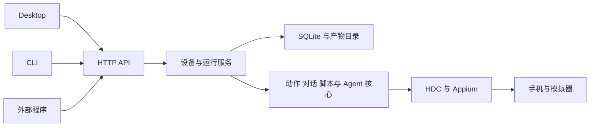
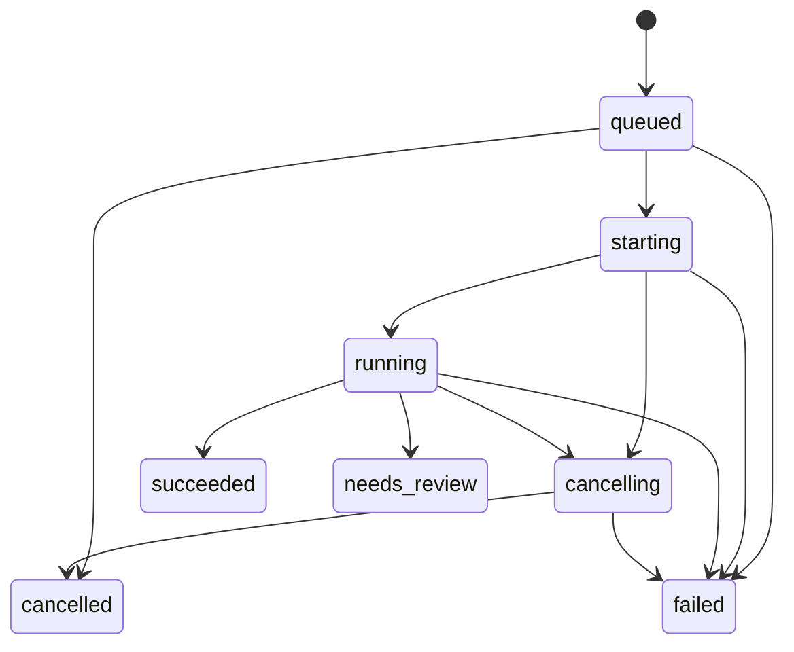

# Open Mobile Use 独立服务与 HTTP API 设计

Open Mobile Use 由运行在设备宿主上的 `omu serve` 统一管理手机连接、运行、对话、脚本和产物。Desktop、CLI 和外部程序通过同一套 HTTP API 操作设备。关闭 Desktop 或退出 CLI 后，服务继续工作。Windows 和 macOS 使用同一个服务程序及接口契约，具体设备能力由宿主环境决定。

## 运行架构



| 边界 | 职责 |
| --- | --- |
| `src/http.ts`、`src/api-contract.ts` | 监听、鉴权、请求校验、状态码、响应、SSE、OpenAPI。通过服务层发起设备运行。 |
| `src/run-service.ts`、`src/api-data.ts` | 设备注册、运行受理、调度和取消。管理对话、脚本、事件、产物和持久化。 |
| `src/service-drivers.ts` | 在服务进程下管理设备适配器、Appium 生命周期和会话端口。 |
| 现有核心 | 复用 `compileCommandStep`、`compileScript`、`executeRound`、`runConversation`、`captureView` 和诊断探针。保持与 HTTP、Electron 和存储无关。 |
| Desktop 与 CLI | Desktop 保留 IPC 作为界面与主进程之间的桥，主进程调用 HTTP。CLI 的设备命令也调用 HTTP。`omu serve` 从 CLI 进入守护进程入口。 |

每台接手机的宿主运行一个服务实例。启动时持有宿主级锁，设备操作都经过同一调度器。沿用本机设备锁作为底层保护。现有 `doctor` 内部也会获取设备锁，提取可在既有会话中执行的诊断探针，防止同一次运行重复加锁。诊断可对已登记但离线的设备运行，探针执行完即返回结果，由 `controllable` 表达设备是否可用。 [设备锁](../src/session.ts) · [现有诊断](../src/doctor.ts) · [现有工作台会话](../desktop/workbench.mjs)

## 设备与驱动

- 服务为每个物理设备分配持久 `deviceId`。驱动标识和 USB、网络等连接信息存在设备注册表内。只有经过驱动或管理员确认的身份才合并。无法确认两条通路是否属于同一设备时，登记一条可操作的通路，其他通路显示冲突。设备标识随连接通路切换保持稳定。
- Windows 支持 Android 和鸿蒙。macOS 支持 Android、鸿蒙和满足 Xcode、WDA 签名要求的 iPhone。服务按平台独立检查依赖。一个平台的工具缺失只影响该平台，状态由设备和能力接口返回。SDK、Java、HDC、Xcode 和签名路径由宿主服务账户配置。 [设备接入](setup.md)
- Appium 由服务监督。默认托管模式使用服务分配的本机端口，只回收由服务启动的进程。外置模式连接管理员配置的本机 Appium，服务管理自己创建的会话。鸿蒙直接用 HDC。为活跃 Appium 会话预留 Android `systemPort`、iOS `wdaLocalPort` 和实际使用的其他转发端口，无冲突资源后才启动。故障或取消后确认关闭再释放资源。 [服务驱动管理](../src/service-drivers.ts) · [驱动会话](../src/webdriver.ts)
- 同一物理设备任意时刻只有一个运行可以打开操作会话。不同设备在各自驱动资源可用时并行。运行期间产生的实时预览从该运行发布，客户端无需另开一个会话采集画面。

## HTTP 契约

业务路径统一用 `/api`。服务从同一份 OpenAPI 3.1.2 契约提供 `/openapi.json`，构建和测试按这份契约校验请求、响应、鉴权和错误。JSON 脚本继续使用 `{platform?, targets?, steps}`。可选的 `platform` 表示手机平台，动作和参数都在扁平步骤对象里。 [OpenAPI 契约](openapi.yaml) · [OpenAPI 3.1.2](https://spec.openapis.org/oas/v3.1.2.html) · [脚本格式](cli.md#脚本和条件等待)

| 方法与路径 | 契约 |
| --- | --- |
| `GET /healthz`、`GET /readyz` | 进程存活、服务能否接单。驱动依赖和各平台状态另由能力接口报告。 |
| `GET /openapi.json` | 返回服务的 OpenAPI 契约。 |
| `GET /api/capabilities` | 各平台和驱动状态、已配置模型配置名、支持的运行种类及有效限制。 |
| `GET /api/devices`、`GET /api/devices/{deviceId}` | 获得授权范围内的设备、通路、可用性和当前占用。列表可传 `refresh=true` 刷新发现。 |
| `GET /api/devices/{deviceId}/pending-actions` | 查询尚待核对的已派发动作。 |
| `POST /api/devices/{deviceId}/pending-actions/{actionId}/ack` | 持有设备锁，核验该次动作之后的同设备观测记录，并保存核对结果。 |
| `GET /api/tasks`、`GET /api/tasks/{taskId}` | 列出或读取可运行的注册 Agent 任务。 |
| `POST /api/runs` | 受理运行。事务提交后返回 `202`、运行摘要和 `Location`。 |
| `GET /api/runs`、`GET /api/runs/{runId}` | 按设备和状态列历史，或读取单次运行的状态、结果、失败步骤、事件游标和产物。 |
| `POST /api/runs/{runId}/cancel` | 停止后续操作。正在取消时返回 `202`，已进入终态时返回 `200` 和当前运行。 |
| `GET /api/runs/{runId}/events` | 使用 `Accept: text/event-stream` 订阅事件，或读取分页 JSON 事件。 |
| `GET /api/runs/{runId}/artifacts/{artifactId}` | 下载该运行的 PNG、录制 JSON 或其他登记产物。 |
| `GET`、`POST /api/scripts` | 列出脚本，或保存脚本 JSON、已有运行录制或对话录制的独立副本。 |
| `GET`、`PATCH`、`DELETE /api/scripts/{scriptId}` | 读取、编辑、归档、恢复或删除用户脚本。内置脚本只读。 |
| `GET /api/scripts/{scriptId}/content` | 下载可直接交给 CLI、Desktop 或 API 的脚本 JSON。 |
| `GET`、`POST /api/conversations` | 列出对话，或为空对话指定设备和标题。 |
| `GET`、`PATCH`、`DELETE /api/conversations/{conversationId}` | 查询、改标题或删除对话。设备绑定在创建时确定。 |
| `GET /api/conversations/{conversationId}/messages` | 按消息顺序查询。用户回复通过新建 `chat` 运行提交。 |
| `GET /api/conversations/{conversationId}/recording` | 导出截至指定已完成轮次的确认步骤。省略轮次则导出至最近已完成轮次。 |

资源 ID 由服务分配。列表用不透明 `cursor` 和 `limit`。历史按创建时间倒序，时间相同时按 ID 排序。消息和事件按序号正序。`PATCH` 和 `DELETE` 使用资源详情返回的强 `ETag` 与 `If-Match`，缺失时返回 `428`，不匹配时返回 `412`。`scriptETag` 来自正文下载，`conversationETag` 来自对话详情。活跃对话的改名和删除返回 `409`。脚本编辑原子替换当前内容，已受理的运行保留提交时固定的正文。 [HTTP 条件请求](https://www.rfc-editor.org/rfc/rfc9110.html#section-13.1.1) · [HTTP 428](https://www.rfc-editor.org/rfc/rfc6585.html#section-3)

### 运行请求和结果

`POST /api/runs` 用 `kind` 决定 `input` 的结构。共同字段为 `deviceId`、`kind`、`input`，以及可选的 `onBusy`、`startWithinMs`、`timeoutMs` 和 `preview`。`onBusy` 默认 `reject`。`queue` 表示允许等待，此时需要给出最长等待时间 `startWithinMs`。需要已有画面观测的单步动作使用 `reject`。`timeoutMs` 从会话开始准备时计时，由服务限制上限。`preview` 默认为 `false`，开启后可收到 PNG 产物事件。

| `kind` | 输入 | 主要结果 |
| --- | --- | --- |
| `capture` | `includeLayout?` | `observedAt`、前台应用、截图和控件坐标系各自的尺寸、方向、控件、稳定性、可操作时的 `observationId`、PNG 产物。原始布局需要诊断权限。 |
| `diagnose` | 空对象 | 工具链、`probes`、`controllable` 和待确认动作摘要。 |
| `step` | `step`、`observationId?`、`conversationId?`、`conversationETag?` | 操作结果和核验。可将已确认的操作加入指定对话的录制。 |
| `script` | `script` 或 `scriptId` 二选一。引用脚本时可用 `scriptETag` 指定读取到的内容。可传 `repeat`。 | 每轮结果、原脚本步骤索引、`failedStep` 和原因。 |
| `chat` | `message`、`conversationId?`、`conversationETag?`、`modelProfile?`、`useImages?`、`record?` | `conversationId`、轮次、`answer`、`replyRequested`、`modelCalls` 和已确认录制。省略对话 ID 时创建新对话。 |
| `agent` | `taskId` 或现有 `task` 文件正文二选一。可传 `modelProfile`、`useImages`、`repeat`。 | 原任务检查点、证据、每轮结果和失败原因。 |

坐标点击和滑动必须带本服务采集的 `observationId`。服务在拿到设备锁后比对前台窗口、目标区域、方向和观测有效期，失败返回 `STALE_OBSERVATION` 并停止派发。采集前后不一致的截图仍可供查看，结果不提供可供坐标操作的观测 ID。图片产物有独立 ID，使视频等控件树不变的画面也能定位到具体帧。脚本继续按其声明的控件及观测条件校验。 [观察采集](../src/inspect.ts) · [现有动作校验](../src/steps.ts)

提交示例使用 `Authorization: Bearer <token>`、`Content-Type: application/json` 和 `Idempotency-Key: <key>`。

```json
{
  "deviceId": "a8038141-136d-4d60-ad1b-a9cf255e3cc7",
  "kind": "script",
  "input": {
    "script": {
      "platform": "android",
      "steps": [
        { "action": "launchApp", "app": "settings" },
        { "action": "waitFor", "label": "蓝牙", "timeoutMs": 5000 }
      ]
    }
  }
}
```

运行摘要包含 `id`、`deviceId`、`kind`、`status`、时间和 `lastEventId`。运行详情另含 `result`、`reason`、`cleanupError` 及产物引用。`reason` 是稳定的机器可读错误码。属于某个端点请求的错误用 `application/problem+json`，扩展字段 `code` 与现有错误码对应。请求结构错误为 `400`，脚本或动作语义校验失败为 `422`，忙碌或幂等冲突为 `409`。已经受理的运行即使失败，查询该运行仍返回 `200`。 [HTTP 202](https://www.rfc-editor.org/rfc/rfc9110.html#section-15.3.3) · [Problem Details](https://www.rfc-editor.org/rfc/rfc9457.html#section-3)

## 调度、取消与故障恢复



1. **受理。** 在一个短 SQLite 事务内按调用主体和 `Idempotency-Key` 查询原运行，校验请求摘要和当前权限，固定脚本正文或对话上下文，写入运行与首个事件。相同键和请求返回原运行。相同键、不同请求返回 `409 IDEMPOTENCY_CONFLICT`。重复请求先查已有映射，再判断脚本或对话是否已更新。
2. **调度。** 同设备的队列按受理顺序出队。`reject` 使用同一事务检查并预留即时运行名额，避免并发受理绕过 `DEVICE_BUSY`。后台出队时检查期限、权限、设备连接及可用驱动端口。排队超时以 `failed` 和 `QUEUE_TIMEOUT` 结束。跨进程锁覆盖会话创建、实际调度及关闭。运行结果未知的设备先允许采集和诊断，暂停后续写操作。
3. **取消。** 排队中的运行可直接取消。已开始的运行改为 `cancelling`，通过 `AbortSignal` 停止后续调度。运行期限耗尽同样停止调度，以 `failed` 和 `RUN_TIMEOUT` 结算。设备动作可能已经发出，须等回执和清理。回执仍无法确认时，以 `failed` 和 `ACTION_OUTCOME_UNKNOWN` 结算，保留待核对标记。客户端断开 HTTP 或 SSE 连接时，已受理运行继续执行。设备资源释放后才提交终态。
4. **恢复。** 重启可继续派发未被领取、仍在有效期内的排队运行。已领取的运行以 `failed` 和 `RUN_INTERRUPTED` 结算。发现待确认动作时使用 `ACTION_OUTCOME_UNKNOWN` 并保留记录。运行中的脚本、聊天和单步动作均从不自动续跑。确认接口要求核对同一设备的新观测，将处理人和结果写入审计。需要操作时由调用方发起新的运行。
5. **关闭。** 服务先停止受理，协作取消已开始运行，等待设备会话关闭后回收自管 Appium 和转发。超出关闭期限的会话标记为待恢复。重启先清理服务能够确认拥有的遗留会话，再允许设备进入可运行状态。 [现有动作流水](../src/session.ts)

### 事件和实时画面

每个运行有持久、递增的事件序号。事件至少包括 `run.status`、`run.progress`、`step.result`、`message.completed`、`artifact.available`。状态及关联事件在同一事务提交。SSE 事件 `id` 为该序号，`GET` 运行详情返回 `lastEventId`。客户端可以从该游标接续，并以序号去重。

SSE 使用 `Last-Event-ID`，JSON 查询用 `after` 和 `limit`。服务按持久游标补发后继续读取新事件，补发与实时连接之间允许重复，避免丢事件。历史已清理时返回 `410 EVENT_CURSOR_EXPIRED` 和运行查询地址。心跳使用 SSE 注释，终态事件发送后关闭。Bearer 客户端使用支持请求头的流式 HTTP 客户端。PNG 通过产物 URL 读取，事件只发元数据和引用。 [SSE 与 Last-Event-ID](https://html.spec.whatwg.org/multipage/server-sent-events.html#the-last-event-id-header)

## 数据所有权

API 服务是运行、对话和用户脚本的唯一写入者。Desktop 通过接口加载历史、更新标题和保存录制。服务使用宿主本地的 SQLite 数据库，产物由服务管理的子目录保存。数据库事务只处理本地状态，设备和模型 I/O 在事务外执行。

Desktop 切换接入时将本地脚本通过现有 JSON 格式导入服务。原有对话文件可保留用于查阅或导出，接入后的对话和录制由服务写入。CLI 仍可将录制和截图下载到用户指定的本地位置。

| 数据 | 存储规则 |
| --- | --- |
| 设备和通路 | 稳定设备 ID、驱动标识、能力、最后发现时间及冲突状态。 |
| 运行、事件和幂等键 | 保存请求快照、状态、结果、事件序号和受理映射。每次状态变更和事件同事务提交。 |
| 脚本 | 标题和来源与脚本正文分开。更新时保存新内容，运行固定所读内容。移动或删除脚本不影响已经提交的运行。 |
| 对话 | 绑定设备。每个对话一次只接受一个活跃的追加运行。底层为每次对话或单步录制追加分配轮次。追加前检查 `conversationETag`，轮次、用户消息（如有）、运行记录与幂等键同事务写入。 |
| 已确认动作和产物 | 记录回调提交成功后再继续下一个动作。录制只包含已确认且已写入的步骤。写入失败以 `RECORDING_WRITE_FAILED` 报告，保留已经确认的可用产物。二进制文件先写临时文件并原子发布，再提交其产物记录。重启后清理没有产物记录的临时和孤立文件。 |
| 凭据 | 按主体管理可撤销的 API 令牌，服务端保存令牌摘要。模型凭据单独交由宿主的凭据存储或进程环境加载。 |

录制下载原样返回脚本 JSON。整段对话录制按提交顺序合并已确认的步骤并固定导出截止点。运行 ID、时间、是否部分完成和文件类型放在产物元数据中。没有确认步骤的运行无需生成空脚本。用户脚本和对话保留至删除。默认运行与其幂等记录保留 30 天，事件 7 天，截图 24 小时，坐标观测 ID 60 秒。通过 `OMU_API_LIMITS` JSON 中的 `runRetentionMs`、`eventRetentionMs`、`screenshotRetentionMs` 和 `observationTtlMs` 调整。受理的队列项和未核对的回执问题保留到处理完成。已过期产物返回 `410 ARTIFACT_EXPIRED`。 [录制生成](../src/recording.ts) · [脚本校验](../src/script.ts)

## 访问权限与部署

- 手动启动的服务默认监听 `127.0.0.1:18765`。工作台自动启动时使用可用的本机端口。本机 HTTP 服务在状态目录发布连接信息，工作台和 CLI 用 `/healthz` 的进程标识核实实例。连接信息仅包含地址和进程标识。
- 本机和远程请求使用同一套 Bearer 鉴权。宿主管理员通过 `omu auth token create` 和 `omu auth token revoke` 管理本地令牌，分配设备范围及读取设备、提交和取消运行、管理脚本与对话、读取产物、诊断等权限。同一主体下的多个令牌遵循各自权限。工作台自动为本机模式签发令牌，并通过系统凭据存储保存。令牌撤销后拒绝后续请求，排队运行重新校验权限，已开始的运行在下一次动作前请求取消。
- 对其他机器开放时由显式启用的 HTTPS 入口提供服务。Appium、HDC 及设备桥接留在宿主内部。浏览器跨域访问按配置允许具体来源。令牌只放在请求头，截图、录制和对话响应使用 `Cache-Control: no-store`。资源访问同时检查设备范围和资源归属，越权请求不返回资源元数据。
- 模型配置在服务端声明。请求通过 `modelProfile` 选择获准配置，`useImages` 默认关闭，并受宿主策略约束。原始截图、输入、对话及布局属于受权限保护的内容，日志只记录请求 ID、主体、操作、结果、错误码和耗时。运行请求以 ID 或脚本正文引用数据，设备桥接子进程的环境只传递工具链配置。 [现有模型配置](../src/chat.ts)
- `omu serve` 可以由工作台启动并独立于工作台继续运行，也可以前台运行或交给系统管理。macOS 使用有设备与签名权限的登录用户 LaunchAgent。Windows 使用有相应工具链权限的用户后台任务。需要在无人登录时启动的部署应使用专用服务账户，并在该账户下验证设备授权和签名。SDK 安装确认、驱动签名和设备授权在宿主完成。
- 独立分发包含 Node 服务、离线 OCR 资源，以及托管模式所需的 Appium 和移动驱动运行依赖。服务按配置探测外置 Appium，诊断分别报告本地组件和运行中的驱动版本。 [当前构建与依赖](../package.json)

## 验收

| 场景 | 通过条件 |
| --- | --- |
| 完全脱离 Desktop | Windows 与 macOS 各自构建、关闭 Electron，经 HTTP 发现设备、截图、操作、对话并重放脚本。各实测结果单独记录。 |
| 跨主机脚本 | 一端导出录制，另一端导入同一文件并在兼容设备重放。覆盖控件、画面文字和图像锚点。 |
| 并发和幂等 | CLI、Desktop 和 HTTP 同时请求同一物理设备只有一方取得会话。同一提交键不会重复派发，不同设备按驱动端口容量并行。 |
| 取消和重启 | 排队取消不执行，派发中取消不提前释放锁。模拟服务崩溃，重启后停在待核对状态，派发计数保持为一。 |
| 观测和事件 | 过期画面、跨设备观测和不同窗口的坐标动作被拒绝。SSE 断线、重连与历史过期都有稳定响应。 |
| 存储和权限 | 更新脚本不影响已受理运行，对话并发追加被拒绝，低权限令牌无法下载产物或操作其他设备。 |
| OpenAPI | 契约验证通过，测试用同一份契约验证路由、请求、成功响应和错误响应，所有受支持运行类型均有端到端用例。 |
